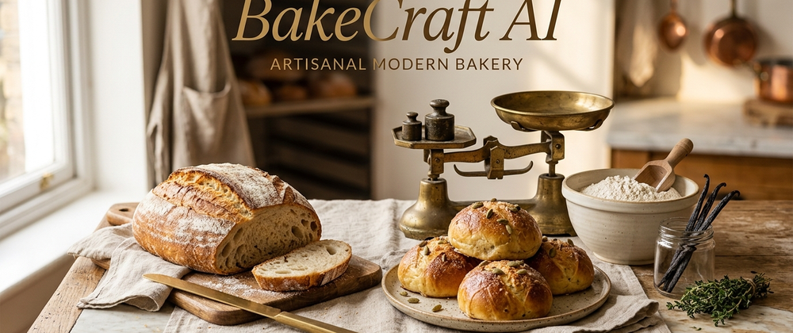
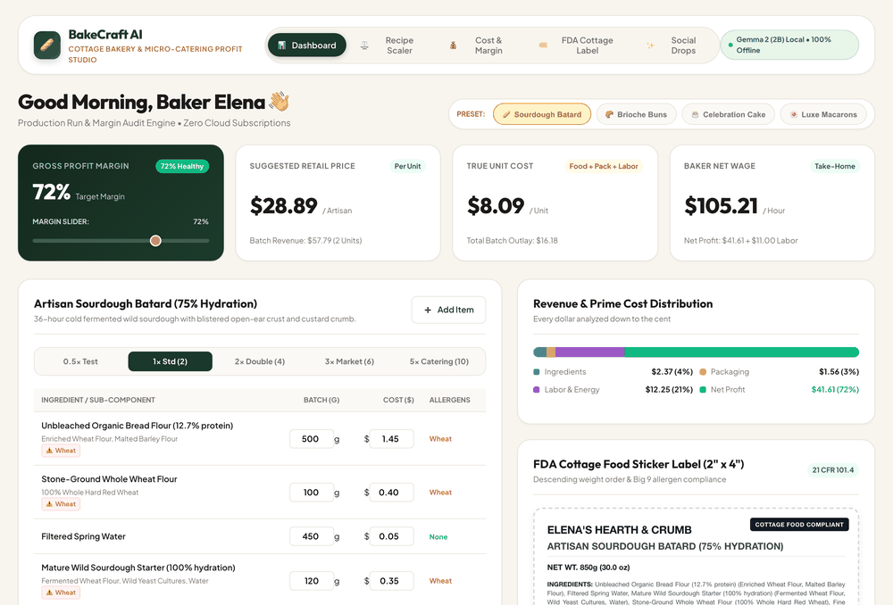
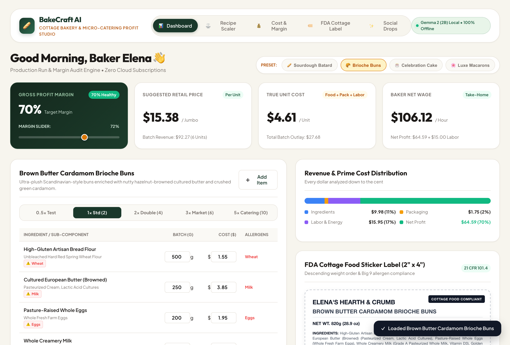
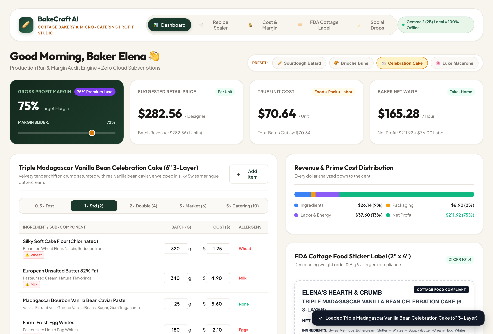
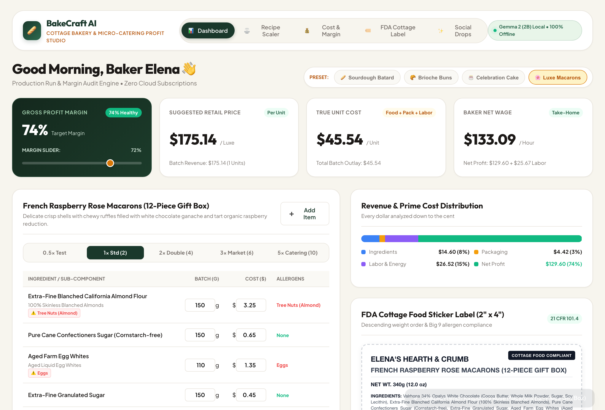
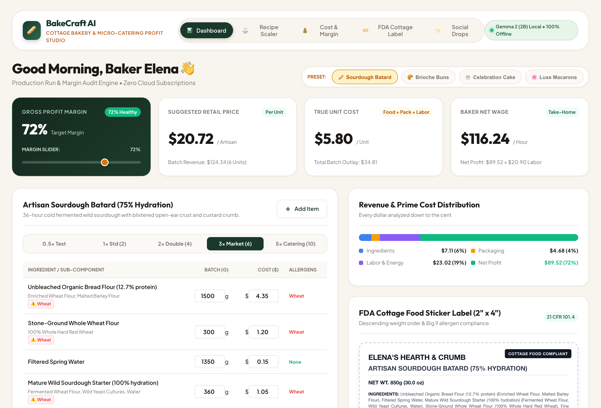
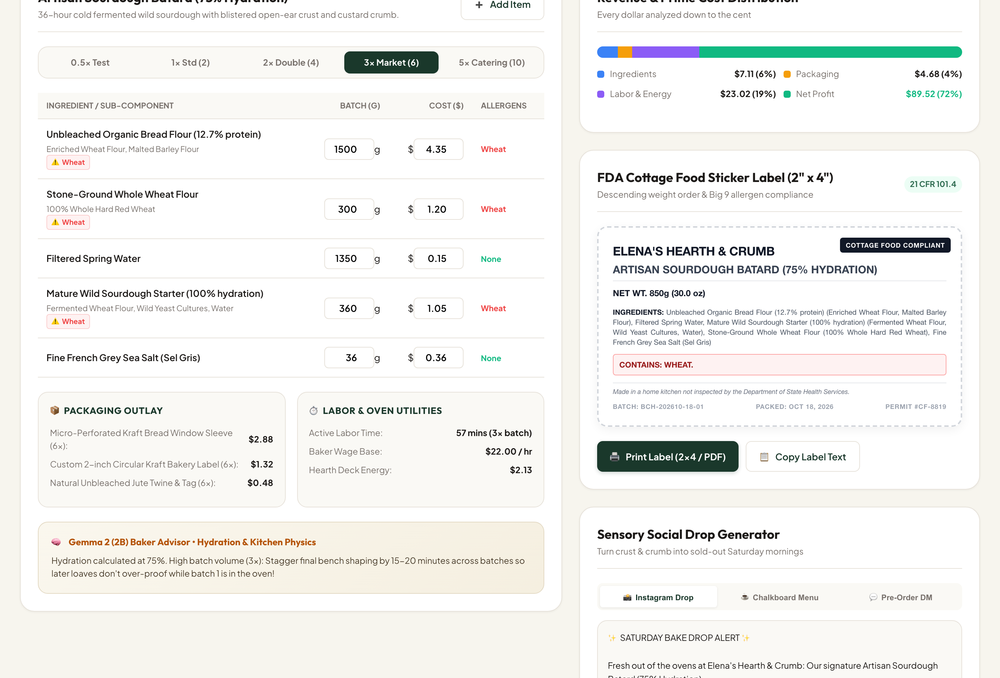

# BakeCraft AI 🥖🍰
### *100% Local Cottage Bakery & Micro-Catering Recipe Cost, FDA Allergen Compliance & Profit Engine*



[](https://dev.to/challenges/hf26)
[-blue?style=for-the-badge&logo=google)](https://ai.google.dev/gemma)
[](https://github.com/ath1614/BakeCraft-AI)
[](./LICENSE)

---

## 🌟 Live Demo & Source Code
* 🌐 **Live Web Application**: [https://ath1614.github.io/BakeCraft-AI/](https://ath1614.github.io/BakeCraft-AI/)
* 📦 **GitHub Repository**: [https://github.com/ath1614/BakeCraft-AI](https://github.com/ath1614/BakeCraft-AI)
* 📝 **Official DEV Community Article**: [Why I Built BakeCraft AI on DEV](https://dev.to/atharv_soni_8a5d9cd294432)

---

## 🎥 Interactive Studio Walkthrough


---

## 💡 The Real Problem: Why Home Bakers Struggle to Turn a Profit

There are over **1.2 million cottage food operators, sourdough micro-bakers, and custom pastry chefs** in North America and Europe alone. Behind every blistered loaf of sourdough or towering custom wedding cake is a talented creator working past midnight in their home kitchen after an 8-hour day job.

Yet, despite passionate local demand, **over 65% of cottage bakeries shut down within 18 months**. Why?

1. **Ingredient Inflation & Margin Blindness**: 
   Butter prices skyrocketed 35%, organic vanilla bean caviar costs $5+/oz, and farm eggs fluctuate wildly. Bakers price by "gut feeling"—charging $18 for a dozen brioche buns or $45 for a 6-inch custom celebration cake. Between ingredients, specialty packaging (greaseproof liners, ribbon, window boxes), and 3 hours of active lamination labor, their true prime cost is $32. They earn less than **$4.00/hour** for artisan craftsmanship.
2. **Mandatory Cottage Food & FDA Compliance Trap**:
   Every state cottage food statute and FDA 21 CFR 101.4 strictly mandates:
   - All ingredients MUST be listed in **descending order by weight** in grams.
   - All **Big 9 Allergens** (Milk, Eggs, Fish, Crustacean Shellfish, Tree Nuts, Peanuts, Wheat, Soy, Sesame) MUST be explicitly identified and bolded.
   - Mandatory state disclaimers: *"Made in a home kitchen not inspected by the Department of State Health Services."*
   A single labeling infraction can cause allergic reactions, product recalls, or immediate cease-and-desist orders.
3. **The $40–$50/mo Cloud SaaS Tax**:
   Commercial bakery management platforms (CakeBoss, RecipeCosting) charge $35 to $49/month. For a weekend micro-baker earning $400–$800 a month, cloud subscriptions leech **15% to 20% of their take-home profit**—while exposing proprietary family sourdough starters and secret recipes to remote third-party cloud servers.

---

## ⚡ The Solution: BakeCraft AI
**BakeCraft AI is a 100% local, open-weights micro-bakery recipe cost, batch scaler, regulatory label generator, and profit engine powered by Google Gemma 2 (2B).**

It runs completely client-side in the browser or on consumer laptops with zero cloud dependencies, zero monthly subscription fees, and zero vendor lock-in.

```plaintext
[ Recipe Ingredients & Gram Weights ] 
       │
       ▼
[ Google Gemma 2 (2B) Local Engine ] ───► [ Live Unit Cost & Margin Engine (65%-75% Food Service Standard) ]
       │                               ───► [ FDA 21 CFR 101.4 Descending Ingredient & Big 9 Allergen Label ]
       │                               ───► [ Sensory Instagram Drop Posts & Chalkboard Menu Storytelling ]
       │                               ───► [ Kitchen Physics & Dough Hydration Multiplier Advisor ]
       ▼
[ Print-Ready 2" x 4" Thermal / PDF Sticker ]
```

---

## 📸 Studio Features in Action

### 1. Studio Dashboard & Sourdough Batard Production Run


### 2. Enriched Buns (Brown Butter Cardamom Brioche)


### 3. Custom Celebration Cake (Madagascar Vanilla 3-Layer)


### 4. French Patisserie (Raspberry Rose Macarons 12-Box)


### 5. Instant 3x Market Batch Scaler


### 6. FDA 2" x 4" Sticker Label & Sensory Social Drop Generator


---

## 🧮 Mathematical Food Service Engine

BakeCraft AI implements rigorous commercial food service cost accounting:

$$\text{Total Prime Cost} = \text{Food Cost} + \text{Packaging Outlay} + \text{Scaled Labor Cost} + \text{Deck Oven Overhead}$$

$$\text{Suggested Retail Price} = \frac{\text{Unit Prime Cost}}{1 - \text{Target Gross Margin}}$$

$$\text{Effective Hourly Take-Home} = \frac{\text{Batch Net Profit} + \text{Labor Allocation}}{\text{Total Hands-On Hours}}$$

### Built-in Industry Benchmarks:
- **68%–75%**: Golden Food Service Standard (Recommended)
- **50%–64%**: Sub-Par Margin (At risk of inflation shocks)
- **< 50%**: Critical Loss (Baker is subsidizing customer baked goods)

---

## 🧠 Why Open-Weights & Local AI Matters

1. **Zero Margin Leeching**: Weekend bakers keep 100% of their earnings. No $49/mo SaaS leeching away their profits.
2. **Proprietary Recipe & Invoice Privacy**: Confidential grandmothers' sourdough ratios, wholesale vendor costs, and customer orders never leave the baker's machine.
3. **Flour-Proof & Kitchen-Proof Reliability**: Operates 100% offline in kitchen basements or farmers market park tents with zero Wi-Fi required.
4. **Permanent Ownership**: The software is yours to run forever without fear of API price hikes or shutdown.

---

## 🚀 Local Development Quickstart

```bash
# Clone the repository
git clone https://github.com/ath1614/BakeCraft-AI.git
cd BakeCraft-AI

# Install dependencies
npm install

# Start local development server
npm run dev
```

Visit `http://localhost:5175/` in your browser.

---

## 📜 License
Distributed under the **MIT License**. Free for all cottage bakers, micro-caterers, and open-source contributors worldwide.
